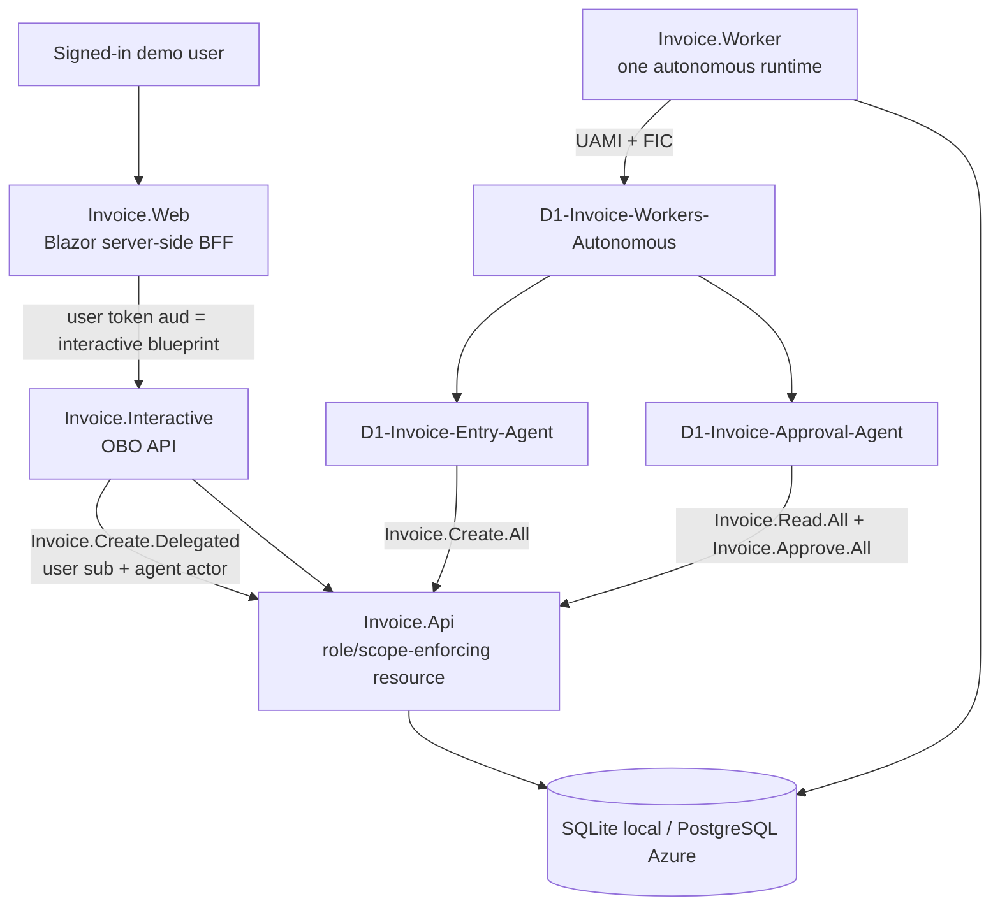

# Fictional Invoice Processing System

The Fictional Invoice Processing System is a separate D1 demo repo that teaches a simple identity lesson:

> **One application can be a team. Keep the shared runtime/credential boundary intentional, and give each accountable actor its own identity, permissions, audit trail, and kill switch.**

This system uses one autonomous runtime with two Microsoft Entra Agent Identities, plus a separate interactive assistant that acts on behalf of a signed-in user. It uses fictional suppliers and invoices only. **No component can initiate a real payment; there is no `Paid` state.**

The existing `AgentDemo-NIC2026` T1 demo is a separate repository and is not modified by this project.

## Current status

- [x] Separate sibling repository and D1-only solution
- [x] .NET 10 domain, deterministic fictional supplier/invoice generator, and manual-review disposition
- [x] SQLite/PostgreSQL EF Core model, unique invoice/PO indexes, optimistic version token, PostgreSQL migration
- [x] Protected API with application roles, delegated scope/business-role enforcement, 401/403 integration coverage
- [x] Autonomous Entry and Approval worker paths, offline mode, run history, negative role tests
- [x] Interactive OBO service and server-side Blazor Web App shell/form
- [x] Four multi-stage Dockerfiles, Docker Compose topology, and five requested design/demo/security docs
- [x] D1-only Entra, Azure foundation, immutable ACR image, and Container Apps deployment scripts with explicit manual identity checkpoint
- [ ] D1 Entra object provisioning/consent and live tenant token proof
- [ ] Docker/Compose runtime validation (Docker is not available in the current environment)
- [ ] Final offline script polish and full post-deployment verification

The full .NET solution builds locally and the test suite is green with the installed .NET 10 SDK. Docker is unavailable here, and Azure provisioning/deployment have **not** been run.

Run the automated local offline smoke with `pwsh -File ./Run-D1OfflineDemo.ps1`; it verifies all four services, five generated invoices, the two agent-role denials, and the interactive no-role 403.

## Identity story

The two autonomous agents share the worker runtime and managed-identity credential boundary, so they share one autonomous blueprint. They remain separate identities because they need independent authorization and attribution. The interactive assistant has a separate blueprint and signed-in user context; it is not an Agent User and has no approval capability.

| Actor | Context | Permission | Allowed work |
|---|---|---|---|
| `D1-Invoice-Entry-Agent` | Autonomous app-only | `Invoice.Create.All` | Generate, create, read own, and submit invoices |
| `D1-Invoice-Approval-Agent` | Autonomous app-only | `Invoice.Read.All`, `Invoice.Approve.All` | List PendingApproval, evaluate, approve/reject, flag manual review |
| `D1-Interactive-Invoice-Assistant` | Delegated, signed-in user remains `sub` | `Invoice.Create.Delegated` plus user role `InvoiceSubmitter` | Preview and submit on behalf of the user |

The API independently enforces each permission. Entry approval attempts and Approval create attempts return 403. Interactive approval attempts are also denied. The interactive API requires both the delegated scope and agent context; the Invoice API additionally requires the signed-in user's `InvoiceSubmitter` role. Invoice list results are owner-filtered for the interactive user.

## Architecture



| Component | Project | Role |
|---|---|---|
| Contracts | `src/Invoice.Contracts` | Shared HTTP DTOs and safe claim/run summaries |
| Domain | `src/Invoice.Domain` | Invoice aggregate, lifecycle rules, suppliers, generator, approval rules |
| Application | `src/Invoice.Application` | Shared `IInvoiceCreationService`, `IActorContext`, approval/run-history contracts |
| Infrastructure | `src/Invoice.Infrastructure` | EF Core SQLite/PostgreSQL, migrations, audit, decisions, run storage |
| Protected API | `src/Invoice.Api` | Enforces roles/scopes/business-role/ownership per route |
| Autonomous worker | `src/Invoice.Worker` | Runs Entry and Approval with separate identities; exposes demo orchestration |
| Interactive OBO API | `src/Invoice.Interactive` | Accepts user token for interactive blueprint and performs OBO with agent context |
| Web UI | `src/Invoice.Web` | Server-side sign-in, invoice entry, dashboard, safe identity evidence |

The UI never receives bearer tokens. Logs, audit records, and responses contain safe summaries only; raw JWTs and authorization headers are not stored or returned.

## Domain and data rules

- Invoice statuses: `Draft`, `PendingApproval`, `ApprovedForPayment`, `Rejected`.
- Manual review is a persisted disposition/reason while the invoice remains `PendingApproval`.
- Autonomous approval cannot decide manual-review invoices and cannot approve an invoice created by the same agent identity.
- Approval rules are deterministic and transparent; over-limit invoices are sent to manual review.
- Fictional supplier names are from the catalog in `Invoice.Domain`; no real bank details, VAT numbers, or personal/supplier records are used.
- Invoice numbers and purchase-order numbers use non-sequential fictional codes and are protected by database unique indexes.
- Seeded offline generation is reproducible; later run seeds advance so repeated runs do not reuse the same identifiers.
- No payment API, payment integration, or `Paid` state exists.

## Local setup

Prerequisites: .NET 10 SDK. Docker is needed for Compose; if unavailable, run API/worker/interactive/web projects individually.

Run tests:

```bash
dotnet test D1.Invoice.sln --configuration Release
```

Run the full offline demo with Compose:

```bash
docker compose up --build
```

Open `http://localhost:8083/`. Offline sign-in choices are available through `/dev/sign-in` (submitter by default; use `?submitter=false` for a user without the business role). Local service endpoints:

- Web UI: `http://localhost:8083`
- Invoice API: `http://localhost:8080`
- Autonomous worker: `http://localhost:8081`
- Interactive OBO API: `http://localhost:8082`

Trigger the offline autonomous flow:

```bash
curl -sS -X POST http://localhost:8081/api/demo/runs/autonomous | jq
```

Prove wrong-role authorization:

```bash
curl -sS -X POST http://localhost:8081/api/demo/runs/negative-tests | jq
```

The negative run proves the Approval token gets 403 on invoice creation and the Entry token gets 403 on approval. Local fake actors use explicit `X-Demo-Actor` headers only in Development/offline mode; live mode requires JWT bearer authentication.

## Endpoints

Protected Invoice API routes:

| Method/path | Access |
|---|---|
| `GET /healthz`, `GET /readyz` | Anonymous health/readiness |
| `GET /v1/suppliers` | Fictional supplier list |
| `POST /v1/invoices/preview` | `Invoice.Create.All` or delegated scope + `InvoiceSubmitter` |
| `POST /v1/invoices` | `Invoice.Create.All` or delegated scope + `InvoiceSubmitter` |
| `GET /v1/invoices`, `GET /v1/invoices/{id}` | `Invoice.Read.All`, Entry-owned, or delegated submitter-owned |
| `POST /v1/invoices/{id}/submit` | Creator permissions; only Draft can submit |
| `POST /v1/invoices/{id}/approve`, `/reject` | `Invoice.Approve.All`; PendingApproval only |
| `GET /v1/audit` | Read role or actor/user-owned audit entries |

Worker routes include `/api/demo/invoices/generate?count=5`, `/api/demo/invoices/approve-pending`, `/api/demo/runs/autonomous`, `/api/demo/runs/negative-tests`, `/api/demo/runs`, `/api/demo/runs/{correlationId}`, and `/api/demo/config`. Worker demo routes require `InvoiceSubmitter` plus `Invoice.Create.Delegated` in live mode.

Interactive API routes include `/interactive/invoices/preview`, `/interactive/invoices/submit`, `/interactive/invoices/mine`, and `/api/demo/runs/interactive`. They require an authenticated user token targeted to the interactive blueprint’s `access_as_user` scope. The OBO call then uses the interactive child agent and delegated API scope; `sub` is checked against the signed-in user.

## Entra and Azure setup

Expected Entra object names:

- Autonomous blueprint: `D1-Invoice-Workers-Autonomous`
- Autonomous child agents: `D1-Invoice-Entry-Agent`, `D1-Invoice-Approval-Agent`
- Interactive blueprint: `D1-Invoice-Assistant-Interactive`
- Interactive child agent: `D1-Interactive-Invoice-Assistant`
- Protected API registration: `D1-Synthetic-Invoice-API`

The autonomous Container App uses a user-assigned managed identity and FIC on its blueprint. Interactive Web and Interactive API use a separate blueprint/credential boundary. Child-agent creation and tenant consent require explicit manual checkpoints. See [`docs/invoice-demo-setup.md`](docs/invoice-demo-setup.md) for exact object IDs, role/scope setup, and environment configuration.

This repo includes deployment scripts only; **they have not provisioned or deployed Azure resources**. The default target is an isolated D1 resource group with D1-prefixed apps. No T1 resource name is a D1 deployment default.

## Build and deployment artifacts

- Four multi-stage Dockerfiles: API, Worker, Interactive API, and Web; each runs full solution tests in its build stage, uses a chiseled non-root runtime, and has a shell-free health check.
- `docker-compose.yml` runs the four offline services and mounts a shared SQLite volume.
- `deploy/entra` provisions D1 identities/roles with a manual child-agent checkpoint; `deploy/azure` creates isolated Azure foundations and Container Apps; `deploy/scripts` builds and records immutable image digests. See [deployment sequence](docs/invoice-demo-setup.md#deployment-sequence).
- Use `dotnet ef migrations list` and `dotnet ef database update` after configuring the PostgreSQL connection for Azure. Do not commit connection secrets; use managed identity/secure runtime configuration.

Detailed docs: [architecture](docs/invoice-demo-architecture.md), [live demo script](docs/invoice-demo-live-script.md), [setup](docs/invoice-demo-setup.md), [security](docs/invoice-demo-security.md), [troubleshooting](docs/invoice-demo-troubleshooting.md).
