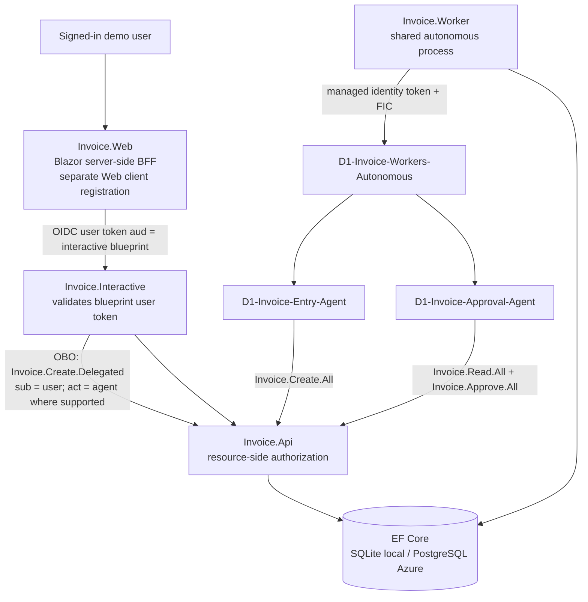

# Invoice Demo Architecture

## Design statement

> One application. One autonomous runtime and credential boundary. Two autonomous identities with separate duties. One interactive identity acting for a signed-in user.

The runtime boundary and attribution boundaries are deliberately different. Entry and Approval share one autonomous worker and one autonomous blueprint because they share code, process, deployment, network, and managed-identity trust. They use separate child Agent Identities because they require different permissions, audit attribution, lifecycle, and kill switches. The interactive assistant uses a separate blueprint and managed-identity credential boundary because its token flow depends on a user assertion and delegated permissions.

## Topology

The Worker owns autonomous token acquisition and execution. The Interactive service owns delegated token acquisition. The Invoice API is the independent authorization boundary and persists invoices, decisions, audit events, suppliers, and safe run summaries.

## Trust boundaries

1. **Autonomous runtime:** `Invoice.Worker` runs as a D1 user-assigned managed identity. An FIC on `D1-Invoice-Workers-Autonomous` trusts the managed identity principal ID with audience `api://AzureADTokenExchange`. The AgentIdentities SDK uses `WithAgentIdentity(entryId)` or `WithAgentIdentity(approvalId)` for separate app tokens.
2. **Autonomous attribution:** Entry gets only `Invoice.Create.All`; Approval gets `Invoice.Read.All` and `Invoice.Approve.All`. The API evaluates those application roles on each endpoint. A valid token with the wrong role returns 403.
3. **Interactive credential boundary:** `Invoice.Interactive` has its own managed identity and FIC on `D1-Invoice-Assistant-Interactive`. The Web confidential client obtains a user token for the interactive blueprint’s `access_as_user` scope. The Interactive API validates that token and passes its `ClaimsPrincipal` into `CreateAuthorizationHeaderForUserAsync` with `WithAgentIdentity(interactiveAgentId)`.
4. **User and agent attribution:** the resulting delegated API token must keep the signed-in user as `sub` and carry the agent as `act` (or the documented Agent ID equivalent). The API requires `Invoice.Create.Delegated`, `InvoiceSubmitter`, and agent context for interactive creation. Live tenant claim proof is a deployment gate; offline mode uses explicit fake actors and does not claim to prove OBO.
5. **Resource-side ownership:** interactive invoice reads require the same delegated create scope and `InvoiceSubmitter`, then are filtered to the user's `CreatedOnBehalfOfUserId`. No browser-supplied user ID is trusted as the owner.

## Data flow

### Autonomous run

1. Entry deterministically generates fictional invoice drafts.
2. Entry calls `POST /v1/invoices`, then `/submit` using its own app token.
3. Approval lists only `PendingApproval` invoices using `Invoice.Read.All`.
4. Approval evaluates transparent rules, then calls `/approve` or `/reject` using its own token and `Invoice.Approve.All`.
5. Above-limit cases keep status `PendingApproval` and set disposition `ManualReviewRequired`; autonomous Approval skips those invoices.
6. Decisions and safe claim summaries are recorded with correlation ID. No payment operation exists.

### Interactive run

1. A real signed-in user authenticates to the server-side Web app. Offline Development uses a fake cookie sign-in.
2. The Web app obtains a user token for the interactive blueprint’s `access_as_user` audience. Browser code never receives the bearer token.
3. The Web server calls `Invoice.Interactive`. The API verifies the inbound blueprint audience and `access_as_user` scope.
4. The interactive child agent obtains the delegated Invoice API token through Microsoft.Identity.Web.AgentIdentities OBO.
5. The Invoice API independently checks delegated scope, agent context, and `InvoiceSubmitter`, then records both the agent and user in audit.
6. The autonomous Approval Agent may later process that invoice; the Interactive Assistant has no approve/reject route or role.

## Data/persistence

`Invoice.Domain` contains the aggregate and state transitions. `Invoice.Application` owns the shared `IInvoiceCreationService` and actor abstraction. `Invoice.Infrastructure` uses EF Core; SQLite is the local Development provider and PostgreSQL is the production provider. The schema includes unique invoice and purchase-order number indexes, invoice lines, supplier catalog, approval decisions, audit events, demo runs, and an integer optimistic concurrency version.

Manual review is a decision disposition, not a second lifecycle state: the invoice remains `PendingApproval` with a reason. The status enum is exactly `Draft`, `PendingApproval`, `ApprovedForPayment`, and `Rejected`. No `Paid` state is modeled.

## Authorization matrix

| Endpoint | Entry | Approval | Interactive user + assistant |
|---|---|---|---|
| Create/preview | `Invoice.Create.All` | 403 | `Invoice.Create.Delegated` + `InvoiceSubmitter` + agent context |
| Read all pending | Only own invoices | `Invoice.Read.All` | Not granted |
| Read own | Only own invoices | `Invoice.Read.All` | Delegated scope + business role, owner filter |
| Approve/reject | 403 | `Invoice.Approve.All` | 403 |
| Mark paid/execute payment | Not implemented | Not implemented | Not implemented |
